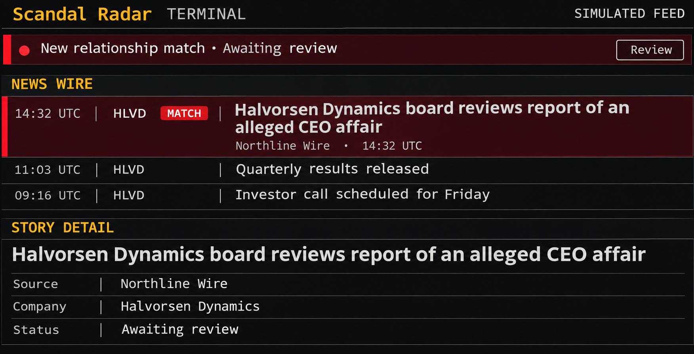

# Scandal Radar

Scandal Radar watches public news feeds for stories that mention an S&P 500 executive, their company and a possible undisclosed relationship. A new matching report turns red in the news wire and can play a two-note chime. Open **Review** to read the original source and assess the claim.

## Quick start

1. [Download Scandal Radar for Mac, Windows or Linux](https://github.com/BoraBora10/scandal-radar/releases/latest/download/scandal-radar-local.zip) and extract the ZIP. It includes the built dashboard.
2. Install **uv** once. It handles Python and the app’s dependencies. [uv installation instructions](https://docs.astral.sh/uv/getting-started/installation/)
3. Open a terminal in the extracted `scandal-radar` folder that contains this README. Run the following command.

```sh
uv run --locked -m api.run
```

Open [Scandal Radar on your computer](http://127.0.0.1:8000). Leave the terminal running while you watch and press **Ctrl+C** to stop. Use the same command to start it again. The first run needs internet access to install dependencies.

**Try an alert.** Choose **Demo**, click **Enable sound**, then **Replay demo** to watch a fictional story develop. Choose **Live** to return to current reporting. Live starts automatically with the public feeds. **Sources** shows which feeds are responding.



*Illustrated alert example with a fictional company and publisher.*

## Run from source

Install uv, Git, and Node.js 22.12 or newer. These commands work in Terminal or PowerShell.

```sh
git clone https://github.com/BoraBora10/scandal-radar.git
cd scandal-radar
npm ci
npm run build
uv run --locked -m api.run
```

Rebuild with `npm run build` after editing the frontend. On macOS and Linux, `make run` also installs dependencies, builds the dashboard and starts the server.

## Optional feeds and settings

For SEC filings, copy `.env.example` to `.env` in the project folder and set `SEC_USER_AGENT` to your application name and real contact email. To add Finnhub, set `FINNHUB_API_KEY` to your own key. Restart the app after changing settings. Public news and Bluesky can run without either setting.

For a replay-only session, set `DEMO_MODE=true` in `.env`. If port 8000 is in use, set `PORT=8001`, restart, and open [the dashboard on port 8001](http://127.0.0.1:8001).

## Terminal functions

Press **/** to focus the command line. Type a function or ticker and press Enter. The same functions are available on the navigation rail. **HELP** opens the function directory.

| Function | View |
| --- | --- |
| MON | Monitor, recent wire, story detail, volume, source health and filings |
| NWS | Search the rolling headline window and inspect original sources |
| MTCH | Relationship-keyword records with an executive and issuer match |
| FIL | S&P issuer filings whose Form 8-K or 8-K/A includes Item 5.02 |
| SRC | Connection health, last check, returned volume and upstream failures |
| DIR | Search tickers, issuers, sectors, executives and aliases |
| DEMO | Play the fictional phase-one tape |

Headlines and summaries come directly from feeds. Published opens the historical distribution of source records by publication or discovery time. Scanned shows the actual number of records inspected per minute, including repeated metadata checked during a poll. The source throughput counter includes EDGAR submission rows inspected and Bluesky messages screened. When viewing the private hosted terminal, the collector heartbeat switches to stale if its most recent update is over 75 seconds old.

## Relationship news alerts

A fresh relationship-news match adds a red banner and a red MATCH row. **Review** opens its source record in the review queue. The red highlight denotes a story awaiting review. Existing matches stay highlighted when you open the desk. Only new report groups chime, with simultaneous arrivals sharing a single two-note alert. A social-only match can trigger that chime when reporting joins the same group.

Keep the live dashboard open for browser sound. Click **Enable sound** to hear the chime and arm it. With the default sound preference, interacting with the desk also arms audio when the browser permits. **Sound on** mutes it when clicked. The same control operates the fictional demo alerts. Muting is remembered on that browser and origin.

## Sources

| Channel | Scope and cadence |
| --- | --- |
| Google News RSS | Ten generic English-language search queries, once per minute during normal operation. Locally match the results. The RSS channel describes personal, noncommercial feed-reader use. |
| PR Newswire | Latest releases RSS, every minute. |
| Business Wire | Personnel news RSS, every minute. |
| GlobeNewswire | Public-company releases RSS, every minute. |
| SEC EDGAR | Rotate through unique constituent CIKs in batches of 24. Check submissions metadata and link the primary filing. Default four requests per second across the poller, with conditional requests and fair-access backoff. Provide your actual contact in SEC_USER_AGENT. A cycle through the universe takes several minutes. |
| Bluesky | Public v2 Jetstream subscription to post commits. Filter text locally, persist acknowledged sequence cursors and reconnect with backoff. |
| GDELT | DOC API ArticleList backup every 15 minutes. GDELT reports first-seen time. The detail pane labels this timestamp basis. |
| Finnhub | Optional free personal-use key. Rotate ten companies per minute through the company-news endpoint. |

Failures and rate limits apply to the individual source. The terminal continues collecting from healthy channels. Accepted records use a six-hour window by default. Missing timestamps are rejected. Matched social posts are retained with provenance. Wire metadata is available for inspection even when it does not match an executive. Routine business headlines and a filing alone do not establish a private relationship.

Provider documentation and live interfaces checked for this implementation include the [Google News RSS channel](https://news.google.com/rss/search?q=CEO%20affair&hl=en-US&gl=US&ceid=US%3Aen), [PR Newswire directory](https://www.prnewswire.com/rss/), [Business Wire feed options](https://www.businesswire.com/help/feed-options), [GlobeNewswire directory](https://www.globenewswire.com/Rss/List), [SEC submissions](https://www.sec.gov/search-filings/edgar-application-programming-interfaces), [SEC fair access](https://www.sec.gov/search-filings/edgar-search-assistance/accessing-edgar-data), [Bluesky v2 Jetstream](https://bsky.network/docs/jetstream/), [GDELT DOC API](https://blog.gdeltproject.org/gdelt-doc-2-0-api-debuts/) and [Finnhub company news](https://finnhub.io/docs/api/company-news).

## Directory and matching

The seed records the date, constituent-table revision, CIK, sector, executives and per-record sources. Wikipedia contributors provide the [constituent list](https://en.wikipedia.org/wiki/List_of_S%26P_500_companies) and role-labeled company infoboxes under [CC BY-SA](https://creativecommons.org/licenses/by-sa/4.0/). Wikidata supplies English aliases and eligible [P169 statements](https://www.wikidata.org/wiki/Property:P169) under [CC0](https://www.wikidata.org/wiki/Wikidata:Licensing). Wikipedia and Wikidata can lag issuer announcements. The November 18, 2026 seed covers all 503 securities across 500 issuers. Source-linked manual corrections take precedence when their conditions match. Unresolved CEOs appear explicitly in DIR.

The collector refreshes the directory daily and retains its last successful snapshot if a source is unavailable. The normalized live copy is cached in `.data/directory.json`. The version in `entities/seed.json` provides offline startup. Refresh independently with `.venv/bin/python -m entities.refresh_directory .data/directory.json`.

Maintain source-linked overrides in `entities/overrides.json`, keyed by ticker. Overrides can supply `company_aliases` and a `ceos` list with `name`, `aliases`, and `source` fields. Optional only_if_unresolved, replaces_names and valid_until fields limit a correction to a missing, superseded, or time-bound assignment. Multiple CEOs are supported. Matching checks word boundaries, aliases and constrained name variations. Common names require the company name. Matching multiple distinct issuers leaves the item unresolved. Share classes are linked by CIK.

SQLite stores a normalized source, URL, publisher, author, timestamp, text and matched ticker. Canonical URLs, normalized titles and tightly similar headlines within a time window group syndications while retaining source evidence. The live view exposes bounded sets of the newest wire, filing and review events. Old records age out; scans for operational metrics are retained for 24 hours.

## Configuration

| Environment | Default | Purpose |
| --- | --- | --- |
| DEMO_MODE | false | Start live collectors. Set true for a replay-only local session. |
| HOST / PORT | 127.0.0.1 / 8000 | Local FastAPI bind address. |
| MAX_ITEM_AGE | 21600 | Maximum accepted record age in seconds. |
| FINNHUB_API_KEY | empty | Optional free personal account key. |
| SEC_USER_AGENT | unset | Enable SEC filings with a descriptive app name and your real contact email. |
| DIRECTORY_USER_AGENT | directory application identifier | Optional operator contact for Wikimedia requests. |
| CEO_OVERRIDES_FILE | entities/overrides.json | Manual executive and alias corrections. |
| DEMO_SPEED | 1 | Replay speed, one of 0.5, 1, 2 or 4. |

`config.yaml` controls the scripted replay cadence and demo alert levels. Local live clients receive FastAPI WebSocket updates every four seconds. The collector owns the SQLite store. Run one collector per installation.

## Optional hosted mirror

The Worker in `site/` can serve the same React client from a separately configured private Site. Its D1 database holds the most recent directory and live snapshot. The publisher on the collector machine updates the snapshot every 15 seconds. Browser clients poll the private same-origin API every 12 seconds. Closing the browser leaves collection running. Machine sleep, process termination or a network outage pauses publication; the terminal shows the timestamp of the last successful write and suppresses expired headlines.

For a restarted or separate collector, set the three optional server-side mirror variables in the environment. `RADAR_SITE_URL` is the private Site origin. `RADAR_SITE_TOKEN` is its Sites service-access bearer. `RADAR_WRITE_KEY` must match the Site's secret of the same name. Obtain service access from the Site owner or the authenticated Sites connector. Keep credential values out of source and the browser. Leave these three variables unset for local-only operation.

## Validation

```sh
uv run --locked -m unittest discover -s tests -v
node --test tests/matchAlerts.test.js
npm run build
```

Coverage includes entity matching, aliases, fuzzy names, common names, canonical URLs, age filtering, cross-source duplicate provenance, distinct filings, and manual override behavior.

## Next phases

3. Add local Ollama classification and evidence-based verification of live candidates.
4. Add opt-in push, Discord, Telegram and desktop delivery plus delayed market context.
5. Extend tests across the completed pipeline and polish filming behavior.

TODO: Google provides a live RSS interface and channel notice; its search URL is not a versioned API contract. Monitor the endpoint and feed terms. TODO: Recheck each provider’s free access and terms before changing deployment audience, licensing, or data usage.

The interface uses a function command line, editable inputs and compact market-data panes. Its terminal navigation draws on the [Bloomberg Terminal getting-started guide](https://data.bloomberglp.com/professional/sites/10/Getting-Started-Guide-for-Students-English.pdf).
